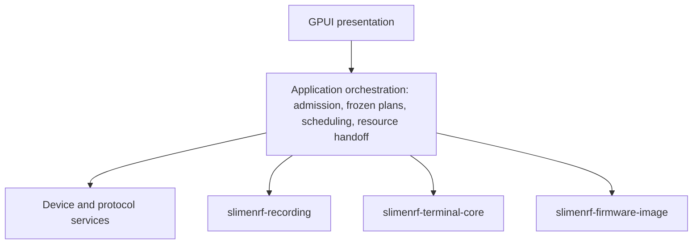

# Architecture

[简体中文](ARCHITECTURE.zh-CN.md)

[Home](../README.md) · [Development](DEVELOPMENT.md) · [Protocol contracts](PROTOCOLS.md)

The project has one product, one desktop executable, and a small Cargo workspace. The root is a virtual workspace; `crates/app` contains the `slimenrf-helper` composition point and is the default member. The internal libraries are `crates/recording` (`slimenrf-recording`) for recording and replay, `crates/terminal-core` (`slimenrf-terminal-core`) for the std-only terminal model, and `crates/firmware-image` (`slimenrf-firmware-image`) for image parsing and content validation. The recording core can be consumed independently but is not released separately. App source, build script and build support live under `crates/app`; shared configuration, translations, scripts, assets and workspace settings remain at the repository root. Module boundaries follow dependencies and resource ownership, not pages or file length. There is no dynamic DLL plugin system or forwarding layer for old paths. The [root AGENTS](../AGENTS.md) and [recording-core AGENTS](../crates/recording/AGENTS.md) define the mandatory engineering rules.

The internal `crates/tools` package (`slimenrf-tools`) owns the shared Rust notice library and the separate maintenance CLI for source checks, release preparation, packaging, and the independent firmware oracle. The app build script uses only the notice library with CLI features disabled; tooling is not a desktop runtime dependency.

## Dependency direction and modules

Unless a package is named explicitly, paths below are physical source locations relative to `crates/app/src`; they are not all Rust import paths.

Capabilities are physically aggregated under `features/<capability>`: their models, services, views, dialogs, workflow and focused tests live together. This replaces a global UI folder, not the dependency model with a set of fully independent features. The [feature namespace](../crates/app/src/features/mod.rs) exposes headless capability modules and standalone retained owners without a Workbench dependency. The [application module](../crates/app/src/application/mod.rs) explicitly declares Workbench-owned adapters using paths into those same capability directories. Those adapters remain logically in `application`; physical proximity does not make them headless or independently reusable.

Concrete coordination remains application-owned: [`device_coordinator`](../crates/app/src/application/device_coordinator.rs) connects `sessions`, `discovery` and receiver-binding changes; [`pump`](../crates/app/src/application/pump.rs) advances retained background work; [`navigation`](../crates/app/src/application/navigation.rs) applies accepted page transitions/activation; [`preferences`](../crates/app/src/application/preferences.rs) propagates locale and preference changes. Moving directories does not redefine cross-capability admission or lifecycle handoff. Features receive explicit requests, shared data or owner callbacks rather than reaching into sibling views. `components` holds stable, genuinely shared presentation such as terminal transcripts, tracker cards and page-scroll geometry; it must not become a second feature/workflow directory. No additional crate, transport broker or compatibility re-export layer is introduced.

| Owner | Responsibility |
|---|---|
| `application` and capability-local application adapters | Workbench composition, shared device admission, page activation, background pumps, navigation, locale synchronization and shutdown handoff. Forms, selection, confirmation and presentation remain with the capability-local adapters; they do not open device handles. |
| `application/lifecycle` | Workbench shutdown payload and transfer, retained cleanup, and shutdown host. Window and quit callbacks remain in `application`; the host finishes after the event loop. Cancellation and join ordering and the nonblocking fallback remain intact. This app-internal ownership does not require another crate. |
| `features/home/application` / `features/commands/saved` | Home navigation, guide and borrowed read-only status / application-owned saved-card composition and cross-feature coordination. Execution remains in the explicit `features/commands/execution` application adapter; no device handles are owned by Home or the library. |
| `features/commands/library` / `features/commands/editor` | Shell-independent saved-card storage lifecycle and retained editor widgets, subscriptions, draft and validation; the application adapter supplies the concrete change callback. |
| `domain` | Endpoints, native USB interface facts, receiver and tracker relationships, identity, and shared receiver serial association and console admission. |
| `discovery` | Passive enumeration and native interface metadata ingestion, the single passive reader for the receiver's main HID interface, and HID leases. |
| `receiver_events` | Shared `Watch` driver for event capability checks, subscriptions, renewal, and bounded stop. Passive discovery and the exclusive calibration worker supply their own filter, mask, and subscription intent. |
| `sessions` | Serial connections, interface-aware recovery identity, current-inventory console admission, control lines, workers, bounded write and display queues, close completion, session generations, serial leases, and the reservation-validated one-use `ReservedConsoleSource` handoff. |
| `components/terminal_transcript` | GPUI terminal presentation, byte-based selection, cached visual rows, scrolling, and optional line wrapping. |
| `rssi_scan` | Bounded parsing of RSSI console tables, source metadata, and sparse measured snapshots. No device access or UI dependency. |
| `features/commands/policy` / `features/commands/batch` | One command catalog, parameter, risk, role, and route authorization, frozen batch targets, and per-target results. |
| `features/commands/model` / `features/commands/store` | Validated ordered saved-card data and bounded transactional storage, separate from preferences and device authorization. |
| `features/device_registry/model` / `features/device_registry/store` | Typed proven hardware keys, bounded remembered records, observation admission, versioned atomic storage, and process-local forget suppression. No GUI or execution authority. |
| `features/device_registry/application` / `features/device_registry/application/observations` | Settings management, live evidence projection, frozen presentation labels, coalesced retained storage jobs, and shutdown joins. |
| `features/commands/execution` | Explicit receiver preparation, one pending frozen saved-command review, direct terminal broadcasts, typed result ownership, page-independent run polling, and per-step admission. |
| `features/capture/session` | Capture identities, admission, conflict checks, draining, leases, pending workers, joins, and release. |
| `features/capture/device` | Real capture sources from the shared inventory and raw HID discovery, frozen source revalidation, capture commands, I/O, handles, and recording workers. |
| `features/calibration/engine/session` | `CalibrationSession`, frozen guide requests, identity pins and aliases, admission, accepted-write draining, reservations, retained workers and joins, result acknowledgement, and release. |
| `features/calibration/engine` / `features/calibration/engine/{direct,wireless,worker}` | Evidence model and reducer, complete console responses, receiver-event association, and the private native calibration worker. Dispatch, application, storage, observation lifetime, and user acknowledgement remain separate. |
| `features/calibration/application` / `features/calibration/application/render` / `features/calibration/application/tests` | Guide state and actions, rendering, and UI behavior tests. The Workbench retains the application session across navigation. |
| `features/firmware/executor` | Execution of admitted frozen data requests, identity revalidation, transport scheduling, and non-localized structured results and progress. |
| `features/firmware/uf2` / `features/firmware/opendfu` / `features/firmware/esb_ota` / `features/firmware/ble_ota` | Device authorization, real volume discovery and copying, and the respective update protocols. |
| `features/firmware/board_catalog` / `features/firmware/remote_config` | External and bundled configuration, exact mappings, and remote-source configuration. |
| `features/firmware/bundled_resources` / `features/firmware/source` | Independent resource identities and bounded integrity-checked reads, HTTP, catalogs, and downloads. |
| `update::Job` | Bounded progress, cancellation requests, retention of async or blocking workers, and joins. |
| `app_runtime` | The continuously driven Tokio I/O runtime, shared HTTP client, and lazy BLE backend shared across operations. |
| `features/app_update/service` | Fixed-repository release selection, frozen asset identity, bounded HTTP downloads, and mandatory SHA-256 verification, separate from firmware updates. |
| `features/app_update/service/windows` / `features/app_update/application` | The native portable replacement transaction and helper protocol / application-owned check, download, confirmation, and restart state. The helper commits only after shutdown joins and replaces the executable only after its parent exits. |
| `hid_log` | Raw records, bounded nonblocking subscriptions, the file format, the writer thread, and on-demand parsing. |
| `features/settings/store` / `features/settings/preferences` / `features/settings/theme` / `i18n` | Preference persistence, retained background saves, theme application, and translations, separate from low-level protocols. |
| [`storage_path`](../crates/app/src/storage_path.rs) | Shared user-store path resolution; command and registry stores derive sibling locations without depending on preference-store internals. Each store retains its own schema, bounds and atomic-commit policy. |
| `features/settings/application` | Retained settings search, typed categories, section anchors, control focus, and grouped presentation. Uses the existing preference update and save path. |
| `components/page_scroll` | Page scroll containers, viewport-edge scrollbars, and page-navigation keys. Does not own forms or device state. |
| `features/device_setup/devices` / `features/device_setup/terminal` / `features/commands/panel` | Application-owned device roster, terminal composition and command sidebar. Shared session, admission and accepted-run owners remain authoritative. |
| `features/replay` | Independent retained replay entity, private replay state, controller, playback, parameters, preset menu and computation lifecycle. |
| `features/rssi` / `features/temperature` / `features/notices` | Independent analysis/document or notices window owners, colocated with explicit application adapters for native-window and device coordination. |
| `features/hid_log/application` | Retained HID browsing, trace projection, recording and file state behind explicit activation and background progression. |
| `developer/gallery` / `test_support` / `application/test_support` | Debug-only synthetic presentation / shared UI test session and executor fixtures / offline Workbench composition fixtures. |
| `crates/recording` | Recording, protocols, normalization, interchange formats, calibration and replay math, analysis, and preset I/O. |
| `crates/terminal-core` | Std-only streaming ANSI and UTF-8 model, bounded scrollback and command history, semantic styles, and selection invalidation. |
| `crates/firmware-image` | UF2, Intel HEX, and MCUboot image parsing, Legacy and Secure DFU package parsing, shared ZIP envelope checks, content validation, and target preparation without device access. |
| `crates/tools` | Shared frozen-input notice rendering and an optional CLI for source publication, release preparation, packaging, and the independent firmware oracle. |

Update interaction policy stays in `features/app_update/application` and the navigation/settings shell: checking does not lock navigation; downloading and a ready update do, with cancellation available. Feature owners do not carry update-specific admission flags or busy-query interfaces. Restart checks the existing firmware, capture, and calibration activity state, then synchronously enters the normal shutdown owner. The shutdown payload retains an explicit downloaded-update intent and prepares/commits installation only after accepted work joins; an ordinary quit discards the download instead.

Application release checks are separate from firmware catalogs. Check-only builds retain release metadata and a fixed-repository page URL, not an installable asset. Windows installation freezes the running executable's identity at startup and revalidates the downloaded asset and destination before replacement. The relaunched application authenticates a versioned [cleanup handoff](../crates/app/src/features/app_update/service/windows/cleanup.rs) before GPUI startup; a retained worker waits for the exact helper process to exit and requires its nonce-bound commit marker before deleting known, identity-checked staging files. This protocol crosses application versions. A process that starts but does not acknowledge cleanup is not killed or rolled back; recovery files remain available.

Windows installation keeps the original path separate from the final sibling filename. Only exact canonical filenames for the current architecture and firmware variant migrate to the frozen release asset name; custom names remain unchanged. Final publication uses an identity-pinned, no-replacement handle rename. A failed process launch attempts restoration at the original path without overwriting competing entries. The cleanup handoff retains its existing protocol and authenticates the actual relaunched path.

The terminal core holds model data; `components/terminal_transcript` and the UI retain presentation and interaction. The firmware-image core checks image content without accessing hardware or a runtime. Image, Legacy and Secure DFU, and shared ZIP-envelope errors expose inspectable failure kinds and preserve nested error sources; the app converts them to text only at presentation or executor boundaries. Content validation does not authorize a device write or establish image authenticity. The app retains resources, transports, device authorization, frozen write purpose, mount and device identity checks, and operation lifecycle.

The recording core's `capture/{protocol,normalize,format}` modules do not access devices. `replay` owns segmented computation and safe FFI. `analysis` owns availability and A/B analysis. `presets` takes an explicit storage path from its caller. Numerical C and CMSIS sources, licenses, and the native build belong to the library's `vendor/vqf` and `build.rs`. The recording core does not depend on GPUI, Tokio, HID or serial access, desktop directories, translations, or application configuration.

The app's `build.rs` handles application configuration and firmware resources, generates license notices directly through the shared Rust library, and tracks changes to the translation directory. Neither full nor no-firmware builds, packaging, or running the application require Python. Debug builds report pending notice review instead of embedding stale notices; release builds and packaging require current reviewed inputs. Neither the terminal nor image library runs the application build script or depends on GPUI or hardware interfaces.

`features/firmware/board_catalog/loading/bounded_yaml` bounds input size and shares expanded text, node, and depth limits across the typed parse. Alias expansion, mapping keys, and ignored fields consume the same limits before schema visitors retain values. Ordinary aliases remain supported. The [parser constants](../crates/app/src/features/firmware/board_catalog/loading/bounded_yaml.rs) define the limits.

The recording core's `replay::presets` reads a flat map of known parameter names to finite numbers or booleans. It rejects unknown keys before reading their values and rejects nested values without traversing their children. Validation completes before a patch changes the effective parameters.

`features/settings/store` bounds preference reads to regular files and revalidates the existing document before saving. Rejected inputs are not permission to overwrite the file. Successful saves retain unknown fields and commit a synced temporary file through same-directory replacement, without truncating the destination first.

`features/settings/preferences` retains one background save and one latest pending snapshot. A newer change replaces the pending snapshot, not the running write. Old completions cannot clear a newer save error. Shutdown retains the running task and saves the latest pending snapshot after it finishes, without filesystem writes on the UI thread.

`file_export` writes terminal logs, replay parameter YAML, and temperature chart SVG through a synced temporary file in the destination directory. It replaces the destination only after writing succeeds. Write, sync, and replacement failures leave an existing destination unchanged.

`features/notices/application` creates the notices window only when requested. Its line index borrows the static original generated into `OUT_DIR` during compilation, and a virtualized list renders visible rows. **Copy all** uses the unchanged embedded text, not the display formatting. The generated document is untracked. The [notice-maintenance procedure](DEVELOPMENT.md#license-notices) owns the tracked source inventory and generation rules shared by compilation and packaging.

## Identity and execution data flow

1. Enumeration supplies candidate endpoints and provable associations. Names, COM ports, and receiver-local slots do not establish permanent device identity.
2. The UI handles selection and form preparation. Application orchestration freezes targets, image sources, write purposes, and calibration tasks. A prepared snapshot is not admission to execute.
3. Admission checks conflicts and fresh identity, drains accepted serial writes before serial reservation, and waits for predecessor workers to join before transfer.
4. Capture, update, and calibration workers consume frozen requests and revalidate identity before execution. View-picker payloads do not decide low-level authorization.
5. The UI displays progress and results. Cancellation or stopping observation retains leases and identity pins until cleanup and worker joins finish. Release does not reconnect automatically or restore an old confirmation.

`SerialEndpoint.usb_interface` keeps the native communication-interface number and description separate from display labels, product names, and manufacturer names. `SerialEndpoint::role()` alone classifies a known raw-data CDC interface. `discovery` reads native metadata from Windows device nodes and Linux sysfs without opening a serial connection. Missing descriptions remain unavailable, and contradictory metadata remains ambiguous. Labels, COM numbers, and MI fragments do not assign a role.

`receiver_serial_ports` associates one current HID receiver with USB serial endpoints through matching USB vendor and product IDs and a unique nonempty serial. It selects an explicitly identified raw-data endpoint and the sole remaining console candidate. This permits a Linux console without an `iInterface` name. Duplicate receiver identities, duplicate communication-interface identities, duplicate raw-data roles, and ambiguous metadata reject the association. Multiple remaining candidates provide no console, and a sole raw-data endpoint never becomes a console.

Manual terminal connections, prepared-command auto-connect, command routes, calibration, dumps, and serial DFU use current-inventory console admission. Frozen endpoint checks include native interface facts without replacing each operation's stronger identity checks. A new sibling can revoke console admission even when the selected endpoint has not changed. Ordinary tracker consoles do not require a receiver HID association. Session recovery distinguishes known communication interfaces but rejects duplicate interface numbers. Recovery remains disabled for composite groups without enough distinct interface evidence.

Recovery belongs to a manually admitted connection lineage. It requires the same canonical port and an exact, unique USB serial, USB ID, and communication-interface identity, current console admission, a joined predecessor, and no blocking reservation. Successful inventory must have been updated within 10 seconds. Failed enumeration invalidates admission without inventing a disappearance.

An automatic open needs a sampled absent-port return, the lineage's one unexpected-loss probe, or an actual Windows global COM-change hint followed by a qualifying scan. The loss probe requires a scan started at or after the loss. The native hint requires a scan started at or after the hint was consumed. These scan-start conditions are independent alternatives, not one combined latest-event threshold. Sampled arrivals remain independent of both. Inventory freshness uses the successful update time and does not establish scan-start provenance.

All pending opportunities, including an unused loss probe, are consumed before one automatic open. Automatic success does not refill them. A global COM hint is not per-device attachment proof. Even an unrelated COM event can permit a fresh identity-checked opportunity. Without native notifications, including on Linux, sampled arrivals and the single loss probe remain available. Without new qualifying evidence, recovery requires manual reconnection. Initial failed opens never arm recovery. Disconnect, **Stop reconnecting**, terminal close, reservation, and shutdown revoke it. There is no blind timer retry, port migration, or command replay.

For a live or recovering session, `SessionManager::request_close` latches close intent once and synchronously revokes recovery. That latch prevents connection or write paths from reviving the session. Ordinary Disconnect retains history without requesting removal. The UI's `can_request_terminal_close` and `can_dismiss_terminal` combine manager guards with `terminal_owners_idle`. Removal waits for the serial worker to join and for command, preparation, reservation, thermal-read, and terminal-export owners to settle. Workbench continues this finalization off-page, retaining the tab and transcript until dismissal is safe.

CDC capture uses the same discovery inventory and association policy, not a second serial enumeration. A source requires unique raw-data and command-console endpoints on the same receiver; both complete endpoints are frozen and revalidated rather than comparing rendered labels. Before START, `sessions` executes a bounded console-activation probe through the existing connected owner, or a temporary reserved console that closes and releases its lease before START. It does not take an existing terminal's handle or retain a console lease during recording. `features/capture/session` still pins both receiver CDC siblings and positively identified RF aliases until worker join; the recording leases belong to the selected serial data port and receiver HID interface. The shared bounded ANSI-line parser lives in `sessions`, with protocol-specific interpretation retained by capture and calibration.

Serial sessions, main HID access, raw capture, and updates must not compete for the same handle. The main HID monitor, OTA, and raw capture use existing ownership and `TracedHid` logging. Diagnostic pages are consumers, not second readers. Related tasks are mutually exclusive. Unrelated devices are unaffected, and changing pages does not change resource lifetimes.

`esb_ota::NativeHid::open_checked` checks enumeration and then verifies the serial number through the opened HID handle. A failed read or mismatched serial rejects and drops that handle before any protocol write. A frozen serialless endpoint is accepted only if the opened handle is also serialless.

`discovery::BindingResetCause` separates confirmed pairing changes, address replacement, endpoint replacement, and manual rediscovery from ordinary liveness updates. Receiver-local invalidation clears future tracker selections, idle capture selection, and firmware-query caches. Late query results cannot restore invalidated data. Accepted operations retain their frozen requests, pins, and leases until cleanup completes. Saved hardware identities and nicknames remain separate.

Receiver console success logs remain pending on the same live serial generation until fresh inventory validates its identity. Ordinary reader handoffs, enumeration, language changes, and DFU preparation do not reset bindings. Only the device roster's explicit refresh requests rediscovery. HID registrations do not provide a complete inventory or deletion marker, so silence cannot prove unpairing. External changes without an observed success or changed address can require manual rediscovery.

`update::UpdateOutcome` keeps protocol completion, unverified activation, and failure separate. `ActivationUnconfirmed(ReceiverActivationReport)` retains submission evidence and receiver availability independently. Its terminal `OtaPhase::ActivationUnconfirmed` is neither active, completed, failed, nor cancelled. Finalization and cancellation preserve that outcome. `FlashState` bounds post-join availability enrichment to eligible retained receiver results, using fresh shared inventory and the frozen physical receiver key. Detection preserves the earlier diagnostic and does not upgrade protocol completion or verify the installed image. Retiring receiver ABORT eligibility before an ACTIVATE write attempt does not release the HID reservation, session ownership, or operation pins before join. The [OTA protocol reference](PROTOCOLS.md#esb-ota) defines the completion and availability evidence.

On the wired-update page, `features/firmware/application/serial_entry` retains frozen serial requests, identification evidence, unknown-device confirmation, and send receipts. It reuses the existing owner in `sessions` and the shared capture and update admission checks instead of opening another serial transport. Healthy connected sessions are reused by generation. New connections require fresh enumeration. Losing identity or enumeration evidence while waiting revokes unsent requests. Accepted requests and receipts survive page changes. Reconnection does not replay `dfu`, and a USB disconnect after send completion does not rewrite the write result. Display metadata such as product and manufacturer does not grant broader compatibility. UF2 volume selection and the Holyiot-specific handshake remain separate.

Holyiot Enter DFU and OpenDFU admission reject a busy serial write queue before reserving or closing the console. Accepted commands finish through their original owner. The user retries the update action after those writes finish. There is no deferred automatic handoff.

Calibration freezes either a direct USB endpoint, predecessor session generation, and tracker address, or a receiver endpoint, receiver-local slot, and RF address. The worker's native-open identity is separate from the predecessor generation. Direct handoff installs the application pin before draining accepted writes, then reserves the console and waits for the old reader to join. `sessions` supplies one console source through its existing native factory and whole-command write path. The worker reopens and checks complete fresh `help` and `info` responses before one operation write. Related command exclusion does not close an otherwise usable receiver console.

While calibration preparation, observation, or cleanup is live, admission blocks related serial writes, connection changes, captures, dumps, updates, and competing receiver readers, including firmware queries. Positive direct and receiver aliases extend the identity pin. After join, native leases are released. One unresolved result can retain an in-memory pin until explicit acknowledgement. Related writes and receiver-wide operations remain blocked, but receiver-local and other positively identified tracker firmware queries can proceed without blocking on the unresolved target. Acknowledgement changes host admission only, not application, storage, or cancellation evidence. The session retains one run and result, not a durable recovery queue.

The stationary and per-axis sensitivity procedures are in [Gyro calibration](USER_GUIDE.md#gyro-calibration). Their evidence limits are in the [calibration protocol reference](PROTOCOLS.md#gyro-calibration).

### Remembered hardware and nickname presentation

The registry is a typed stable-key map, not an alias graph. `slimenrf_receiver_usb_serial_v1` contains the supported receiver's 16 canonical hexadecimal USB serial digits, backed by Nordic `FICR.DEVICEID`; `slimenrf_tracker_rf_deviceaddr_v1` contains the 12 canonical hexadecimal RF address digits from `FICR.DEVICEADDR`. The pinned [receiver USB implementation](https://github.com/jitingcn/SlimeVR-Tracker-nRF-Receiver/blob/aad8eae3ec8745bbc35c2ca638ac8468c7eed0bc/src/usb.c#L48-L104), [tracker console](https://github.com/jitingcn/SlimeVR-Tracker-nRF/blob/8aa61a6ce0a9e3bc6f45564656f808827da5de01/src/console.c#L1145-L1154), and [receiver registration](https://github.com/jitingcn/SlimeVR-Tracker-nRF-Receiver/blob/aad8eae3ec8745bbc35c2ca638ac8468c7eed0bc/src/hid.c#L227-L246) establish these namespaces and direct/RF agreement. Addresses are not guaranteed globally unique: conflicting simultaneous claims reject admission. COM names, HID paths, receiver-local slots, product names, and guessed USB/BLE conversions are never permanent keys.

`ObservedDevices` admits current receiver inventory facts, receiver registrations, and direct tracker evidence only under their distinct proof rules. Direct evidence requires known tracker role, a normalized address, and `SessionManager::connected_identity_for` matching the current native endpoint and connected generation. Cached identities cannot be attached to a new endpoint at the same COM name. Historical pairings supply address-only identity; they neither make a row current nor update metadata. Firmware metadata is accepted only when the existing query snapshot proves the same receiver hardware and tracker RF identity; path-plus-slot coincidence is insufficient. No query is started for the registry. Optional fields retain last-reported values and never supply firmware capabilities or execution/reconnect authority.

Tracker records have an optional `last_receiver` receiver `DeviceKey`. Registry validation rejects other owner or target roles. A unique recent RF claim can replace the key only when the monitor's frozen path, native key, and USB serial match the current receiver and no monitor error is present. Offline pairing lists, direct serial identities, absent receivers, and ambiguous claims cannot replace it. A missing observation value preserves the key. This prevents an old receiver's offline pairing from replacing a newer receiver after the newer one disappears. The field defaults to absent in existing version-1 files without a load-time rewrite. It supplies no routing or execution authority.

`features/device_registry/store` owns version 1 of `device-registry.json`, beside preferences but independently persisted. Records and process-local suppression are bounded to 1024 identities, with bounded UTF-8 text and file size. Real mutations re-read and validate existing data, sync a same-directory temporary file, atomically replace the destination, and only then publish the committed snapshot. Invalid data and failed writes retain the previous snapshot and editor draft. Unchanged observations do no filesystem work. GUI state owns one retained background store operation and coalesces identity, metadata, and receiver association changes, not terminal chunks or TPS fluctuations. Shutdown stops edits, joins in-flight work, and drains ordered pending observations outside the UI callback.

Nickname edit completion retains the store's validation-versus-persistence distinction. Validation feedback belongs only to the matching active editor instance and disappears with its draft; opening or canceling an editor does not clear independent storage failures. Both the manager and current-device editor expose storage recovery separately. Registry keyboard traversal shares Settings' focus-entry reveal geometry in `components/page_scroll`: retained per-control focus scopes request a next-frame refresh, then reveal already-scrolled prepaint bounds once. Ordinary redraws preserve manual scrolling, and focused inputs keep their own navigation keys.

Forget removes one app-local record without touching hardware or other user data. The store suppresses its automatic recreation while continuously observed. The UI retains bounded current carrier facts: physical receiver serial or direct USB identity, not a route history. Only a clean complete inventory proving every previous carrier absent releases suppression; replacement at a reused path is not old-hardware presence. Failed enumeration, monitor reservation, and traffic expiry do not release it. Absence is committed before a coalesced return; older queued observations cannot undo Forget or Rename. Explicit Remember uses the currently admitted raw observation. Restart clears suppression; neither path restores the removed nickname.

The manager resolves the receiver nickname or reported name from the current registry at render time and includes the stable USB serial in the full tooltip. Forgetting a receiver preserves tracker relation keys but deletes that receiver's names. A missing receiver record produces an identity-only label and never recreates the record. Forgetting a tracker removes its relation under the existing suppression rules.

Nickname formatting is presentation-only and preserves physical/default labels. Live selectors consume current admitted evidence. Retained calibration, HID records, ESB results, and confirmations use frozen keys or frozen supported native facts, never a current path/port/slot lookup. Mixed or unproven HID filter groups use neutral labels. Prepared command reviews and accepted runs preserve their captured captions exactly, including terminal broadcast target labels; controls still relocalize and reopening a review captures new captions. A query failure carrying only frozen path/text keeps its original failure label. Port-only `ResultIdentity::Serial`, frozen serial tracker endpoints without RF proof, slot-only HID/replay history, UF2, bootloader, and Legacy BLE labels intentionally remain unchanged. No executor fields or protocol identities are widened solely for nicknames. Raw logs and recordings are unchanged.

### Saved custom commands

`SavedCommands` holds one ordered card vector with stable document-local IDs and a pinned flag. Home filters that vector without a second ordering registry. Saved data contains command lines and target modes, not device identities or approvals. Model validation bounds metadata, lines, macros, and library size. `features/commands/store` owns the versioned `custom-shortcuts.json` sibling of `preferences.json`. Each mutation re-reads and validates the file, prepares a proposal, writes and syncs a bounded same-directory temporary file, and atomically replaces the destination before publishing its snapshot. Failure retains the previous snapshot and editor draft. Invalid existing data is not rewritten.

For saved cards, `features/commands/execution` freezes the invocation, exact endpoint and receiver facts, canonical port, session generation, effective payloads, and review labels. Connected-terminal mode uses existing admitted connected consoles and never opens a connection. Receiver modes prepare only explicitly chosen consoles through the existing connection path. The inline saved-command review is consumed once. Later selection or input changes cannot retarget accepted work.

Terminal **Send all** instead captures a `TerminalBroadcast` with the exact source draft and frozen current Connected targets, then submits it in the same click. Already disconnected, connecting, or faulted sessions are not members of that invocation. Currently connected targets that fail console or operation admission retain their exclusion reasons. This direct path never creates or consumes `PendingCustomCommand::Review`, opens a connection, or retries a write. Terminal input changes and clearing do not invalidate an unrelated saved review. Immediate terminal errors belong to `TerminalSession.status`. `CustomCommandState.error` remains saved-review-owned.

Every `CommandRun` has a typed `CommandOrigin`. Home displays only `SavedCommand` runs, including saved cards in Connected-terminal mode. The command sidebar's History reads every retained `Terminal { source_port }` run directly, labels its source, and provides expandable per-target details. `CommandSidebar` owns expansion state keyed by `RunId`. History counts and renders terminal runs alongside the existing `batch_history` rows without copying receipts or results into a second store. Sending does not select History, and changing the selected terminal does not filter its terminal runs. Settled terminal results have an X dismissal action. Active accepted receipts offer Stop and cannot be dismissed. The existing 16-run limit can evict only settled fully successful results. Failed, skipped, cancelled, or excluded evidence remains until explicit dismissal. If no result is evictable, submission fails before any write.

`CommandRun` retains independent per-target progress and one accepted `WriteReceipt` per target. Each next line revalidates current inventory, native interface identity, receiver association, generation, role, route, reservations, operation conflicts, and frozen command authorization. Raw CDC remains excluded by shared console admission. Failure skips only that target's tail without retry or fallback. Cancellation skips unsubmitted lines but keeps accepted receipts until they settle. Accepted effective lines enter each target's existing history. Source clearing requires an accepted submission and unchanged source text. This path neither adds a serial transport nor changes built-in one-step batch preflight.

[`SavedCommandsState`](../crates/app/src/features/commands/saved.rs) owns the library, editor, target/review presentation and expanded run rows; [`CommandLibrary`](../crates/app/src/features/commands/library.rs) owns the store, committed shared snapshot, errors and one retained background store job. [`CommandEditorState`](../crates/app/src/features/commands/editor.rs) owns its input entities, subscriptions, draft and validation. The library and editor do not depend on Workbench or the application namespace; the editor retains the concrete owner callback supplied at construction. `HomeState` owns only Home navigation and guide position. A weak completion callback applies a finished store result through the owner before releasing its busy state. Failure preserves the old snapshot and editor. Shutdown stops edits, drops the foreground callback and transfers the actual store join to lifecycle cleanup. Workbench coordinates saved-review invalidation and the existing preparation/confirmation methods; accepted custom runs remain in the single `CustomCommandState` across navigation and stop later submissions before session cleanup.

## Background work and shutdown

GPUI keeps its own executor. Serial, HID, capture, and calibration loops, along with replay CPU computation, use dedicated blocking workers. HTTP and BLE use the app-owned Tokio runtime, connection pool, and BLE manager reused after successful initialization. Each operation enumerates adapters again. CPU and file work such as JSON, ZIP, digests, and image processing runs in blocking tasks whose joins are retained. It does not block the UI or the Tokio driver.

Replay computation workers, replay preset I/O, terminal exports, and thermal file work retain their joins. Accepted file work stays owned independently of a cancelled UI completion callback. Shutdown transfers these joins to cleanup and waits for the actual work rather than detaching it.

[`ReplayFeature`](../crates/app/src/features/replay/view.rs) is an independent entity that privately owns replay state, widgets, subscriptions, model view, controller and workers. Its constructor retains the window without initializing widgets; the first explicit activation initializes inputs, focus, model and subscriptions once and starts preset loading. Deactivation pauses animation and releases transient captures, while polling owns debounce and generation-checked computation completion; render does not hide or initialize the feature. Canvas and menu callbacks hold its weak entity, not Workbench. The preset dropdown builds one snapshot when opened through that weak owner and retains it for that popup, instead of cloning the library during each render or adding another cache. Playback's shared speed setter first settles elapsed time at the old speed, then changes the speed; selecting the same value does not restart the clock, and paused playback only changes the selected speed. Keyboard and menu commands use the same method. Shutdown transfers computation and accepted preset-I/O joins to the existing cleanup owner.

The [RSSI window](../crates/app/src/features/rssi/window.rs) owns its document, focus and import task; live updates carry concrete frozen port/generation/scan snapshots. The application adapter drains the existing session observations and owns native open/reuse and close tracking. The [temperature window](../crates/app/src/features/temperature/window.rs) owns its document, analysis queue, chart cache, chooser, export joins and native-window lifecycle; its typed `TemperatureRequest` reports acquire/cancel intent through a weak application callback. The adapter still owns hardware admission, session writes and result delivery. The [notices window](../crates/app/src/features/notices/window.rs) owns its static line index, scroll and render state; list callbacks use its own weak entity. Its adapter owns native open/reuse, locale title updates and shutdown. Closing an analysis window preserves its document; application shutdown stops owners and retains accepted file joins. None of these boundaries introduces another device reader or a generic event bus.

Workbench polling advances calibration preparation, snapshots, cleanup, and joins even when the guide is hidden. Navigation neither stops nor retargets a run. A displayed terminal result can still receive storage-error evidence while observation continues, and does not imply that cleanup has joined.

Shutdown first requests cancellation or the end of host observation. It takes the calibration worker before shutting down the session and receiver managers. An independent cleanup thread joins that worker, including bounded event-unsubscribe cleanup, before finishing manager cleanup and lease release. Shutdown does not wait for firmware calibration to finish. After GPUI exits, shutdown waits for the cleanup thread to finish before stopping Tokio. Cancellation does not prove that a worker has stopped. BLE cleanup must not be aborted or detached, and the UI must not use `block_on` for cleanup.

## Presentation and performance boundaries

Rendering reads state and composes elements. Device-command continuation, session/tab reconciliation, editor completions and pending source clearing advance from retained serial/background pumps and accepted actions, not from page rendering. OTA workflow reconciliation instead uses one retained self-observer: selection, query, image and review changes notify the owner through their existing paths, and prerequisite checks run only when that owner is notified. A real retreat clears stale review and acknowledgement and notifies once more to reach a stable state; the workflow never automatically advances or scans on idle pump ticks. Production and offline Workbench owners retain the observer subscription, and reconciliation is skipped during shutdown. Weak window/entity updates handle closed owners. Independent entities, including replay, notify for their own coherent presentation changes. Replay-only changes do not become shell changes, trigger the firmware-workflow observer or refresh the registry projection. Existing identity, generation, receipt, admission and join guards still run immediately before writes. Hidden pages continue accepted work without depending on redraws.

HID page activation explicitly initializes its retained subscription, layout and focus before presentation. Its background owner continues bounded trace consumption and file completion while hidden; only the visible page refreshes its display. Browsing/rendering does not initialize or poll it, and leaving the page does not cancel accepted recording or snapshot work.

Application commands use semantic `Button` controls rather than clickable containers: command/history tabs, firmware source choices and capture cards share their existing owner methods across pointer and keyboard activation. OTA selection, checkbox and Retry are sibling interactions, so retry does not also toggle selection. UF2 preset IDs combine frozen volume identity, resource/category and stable configured-target identity rather than list position. Distinct named variants remain independent even when they share a resource; candidates are not deduplicated and device authorization is unchanged. The [shared clipped-text helper](../crates/app/src/components/mod.rs) accepts `SharedString`, converts once and cheaply shares it with text and tooltips. Retained Workbench command/inventory/general errors and terminal status publish `SharedString` at the UI boundary; policy, native and domain errors remain ordinary `String` values without GPUI coupling. These remove interaction and ownership antipatterns; they are not measured FPS, allocation or latency results.

`FeaturePage::Home` is the launch page after successful preference loading. A preference-read failure keeps the Settings fallback. `HomeState` retains the current Home view and guide position only in memory. Navigation uses the existing feature transition path, so visiting Home does not close sessions or cancel authorized work.

The Home status projection reads existing discovery, listener errors, receiver reservations, and recent tracker sensor activity. Tracker slots remain scoped to their receiver. Unknown counts stay unknown during discovery failures, reader failures, or resource handoff. The projection neither acquires leases nor starts another reader, and its counts do not assert pairing or setup completeness. Browsing Home does not initiate device operations. Explicitly opening Wireless update preserves the remembered mode and delegates to the existing page lifecycle. ESB mode starts `FW_INFO` queries. Legacy BLE mode does not.

`SettingsUiState` retains the search input, selected `Section`, navigation width, scroll handle, section anchors, and control-focus subscriptions. The setting catalog links localized search text to its group and control. Search state is separate from `Preferences` and is not persisted. Preference errors remain outside the filtered list. `Sidebar`, `GroupBox`, `Input`, `Button`, and `Switch` provide the component behavior. The application owns their composition.

Repeated device, firmware, and report controls use domain-derived element IDs rather than display positions. Device selection remains separate from current-target focus. A disabled tracker checkbox blocks pointer fall-through to the card body without blocking scrolling.

The terminal separates its lossy display buffer from lossless structured observation, and reports display overflow explicitly. Identity and RSSI observation share the serial worker's `ConsoleLines` line assembler. Each RSSI worker retains one pending snapshot. Consumption determines whether this is the scan's first delivery and binds the snapshot to the actual port and session generation. Observation adds no serial handles or command transactions. Automatic reconnection still requires the existing fresh-enumeration and identity admission checks. The separate RSSI plot window opens automatically only on a new scan's first delivery. Appends to that scan do not take focus. Closing the window retains its document, and appends from an old scan cannot overwrite a file document after a successful import.

`components/terminal_transcript` keeps physical lines and their UTF-8 byte offsets separate from visual rows. Soft wrapping uses native `StyledText` geometry without adding line breaks to copied or exported text. Visible lines and selection endpoints use the current terminal width before painting. Other history reflows in bounded batches. Hidden terminal tabs do not schedule reflow.

Each `TranscriptState` owns its tab's log-level filter and projects retained source rows into contiguous display byte offsets while retaining physical line IDs. Exact-level filtering keeps unclassified output visible and never changes serial observation or the terminal buffer. Selection copying uses the projection; Copy all and export use the complete retained buffer. Filter changes invalidate text selection and stale layout corrections, while surviving rows retain their cached text and layout.

Theme and font changes discard cached `StyledText` layouts, which retain resolved colors and font metrics. History and semantic ANSI runs remain intact. The existing bounded reflow rebuilds layouts with the current style, so theme changes recolor retained text without new serial output.

`components/terminal_transcript` preserves a paused viewport as a physical-line ID, UTF-8 byte, row affinity, and intra-row position. Layout samples the raw scroll offset before GPUI clamps it during prepaint. Logical offsets stay continuous. Painting, selection, and hit geometry share the translation snapped by `Window::pixel_snap_point`. Deferred corrections check the actual prepaint offset to preserve intervening input.

`ScrollHandle::bounds()` supplies the viewport used by anchors, Follow, and keyboard navigation. Fast may enlarge `Window::content_mask()` for its paint cache. That mask controls paint coverage only. It never changes the scroll position.

The transcript's keyboard caret uses the same UTF-8 byte positions and shaped visual rows as pointer selection. Vertical navigation retains a preferred column until layout metrics change. Selection, copying, and export do not insert display-wrap line breaks. Keyboard navigation pauses output following without changing serial reception.

Each terminal tab reserves space for its close button. The button is visible while its tab is hovered or the button has keyboard focus, so revealing it does not shift the layout. Owner checks can disable the button while work is active.

Connection controls reserve stable outer widths while the colored status badge fits its text. Routine closing uses neutral feedback without changing the session lifecycle. Tab labels retain device identity. A fixed-size status dot and the accessible label convey state without resizing the tab.

Replay prepares bounded multi-plot data for the channels that are actually available. Cursor readings use original frames, and the model caches projections. Hidden views must not stop capture or sessions. Shared components unify only genuinely identical layouts or pure functions, such as tracker grids, TPS styling, and serial-port-name comparison. Each page retains ownership of selection eligibility, identity, protocols, and resource authorization.

These are current implementation boundaries, not conclusions about FPS, latency, cross-distribution support, or physical-device acceptance. Missing capabilities and release requirements are maintained only in the roadmap.

## Translation ownership

Application text is stored in [locales/en.yml](../locales/en.yml) and [locales/zh-CN.yml](../locales/zh-CN.yml). The filename specifies the language. YAML nesting forms the dotted keys used in code. `rust-i18n` embeds the text at compile time, so release packages do not need separate translation files. English remains the fallback for missing translations.

Keys describe their purpose and do not change when the wording changes. For example, `commands.preset.info.title` is a command name, while `hid.record.device_info` is an HID record type. Both currently display `Device info`, but are maintained separately. Text shares a key under `common` only when both its meaning and its use are the same.

The application owns translated titles, controls, current phases and input hints. Workbench coordinates explicit locale-change propagation to retained capability owners, including replay's `locale_changed` and native analysis/notices title refreshes; synchronization is not deferred until rendering. Input entities, entered values and editor drafts remain unchanged. Existing operation results, errors and history messages retain the language in which they were generated. Device text, command values and user preset names are not translated. The recording core returns its own enums or errors; the application decides how to display them.

The procedure for adding or changing text is in [Change UI translations](DEVELOPMENT.md#translations).
