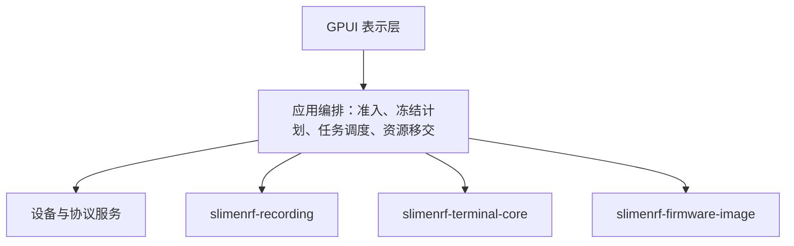

# 架构

[English](ARCHITECTURE.md)

[首页](../README.zh-CN.md) · [开发步骤](DEVELOPMENT.zh-CN.md) · [协议契约](PROTOCOLS.zh-CN.md)

一个产品、一个桌面可执行文件、一个小型 Cargo workspace。根目录是虚拟 workspace；`crates/app` 中的 `slimenrf-helper` 是装配点和默认成员。内部库包括负责记录与回放的 `crates/recording`（`slimenrf-recording`）、仅依赖标准库的终端模型 `crates/terminal-core`（`slimenrf-terminal-core`），以及负责镜像解析与内容校验的 `crates/firmware-image`（`slimenrf-firmware-image`）。记录内核可独立消费，但不独立发布。应用源码、构建脚本和构建支持位于 `crates/app`；共享配置、翻译、脚本、资源和 workspace 配置保留在仓库根目录。模块划分按依赖与资源所有权，不按页面或文件长度；不建立动态 DLL 插件系统或旧路径转发层。强制工程规则以[根 AGENTS](../AGENTS.md)和[记录内核 AGENTS](../crates/recording/AGENTS.md)为准。

内部 `crates/tools` 包（`slimenrf-tools`）持有共享 Rust 版权材料库及独立的维护 CLI，负责源码检查、发布准备、打包和独立固件 oracle。应用构建脚本只使用关闭 CLI feature 的版权材料库；工具不是桌面应用的运行时依赖。

## 依赖方向与模块

下表中除显式标明包的路径外，均为相对于 `crates/app/src` 的物理源码位置，不全部对应 Rust 导入路径。

源码按能力物理聚合到 `features/<capability>`：同一能力的模型、服务、视图、对话框、流程和针对性测试放在一起。这替代全局 UI 文件夹，不意味着所有能力已完全独立。[features 命名空间](../crates/app/src/features/mod.rs)只暴露不依赖 Workbench 的无界面能力模块及独立保留状态的所有者；[application 模块](../crates/app/src/application/mod.rs)用显式路径声明位于这些能力目录中的 Workbench 应用适配器。适配器的逻辑归属仍是 `application`，物理相邻不代表无界面或可独立复用。

具体协调仍归应用：[`device_coordinator`](../crates/app/src/application/device_coordinator.rs)连接 `sessions`、`discovery` 与接收器绑定变化；[`pump`](../crates/app/src/application/pump.rs)推进保留的后台工作；[`navigation`](../crates/app/src/application/navigation.rs)执行已接受的页面切换／激活；[`preferences`](../crates/app/src/application/preferences.rs)传播语言及偏好变化。跨能力准入和 lifecycle 移交不由目录移动重新定义。能力间传递明确请求、共享数据或所有者回调，不访问相邻视图内部。`components` 仅持有真正稳定共用的表示，如终端文本、追踪器卡片和页面滚动几何，不能成为另一处功能／流程目录。本次没有新增 crate、传输 broker 或兼容路径转发层。

|所有者|职责|
|---|---|
|`application` 与能力目录内的应用适配器|Workbench 装配、共享设备准入、页面激活、后台推进、导航、语言同步和退出移交；表单、选择、确认及表示保留在相应能力的应用适配器，不打开设备句柄|
|`application/lifecycle`|Workbench 退出载荷与移交、保留的清理工作及 shutdown host；窗口和退出回调仍在 `application`，host 在事件循环结束后完成清理。保留取消与 join 顺序以及非阻塞回退；这是应用内部所有权边界，无需新增 crate|
|`features/home/application` / `features/commands/saved`|首页导航、指引及借用的只读状态／应用持有的已保存卡片组合与跨能力协调；执行仍归显式的 `features/commands/execution` 应用适配器，首页和命令库不持有设备句柄|
|`features/commands/library` / `features/commands/editor`|不依赖应用壳的已保存卡片存储生命周期，以及保留的编辑器控件、订阅、草稿和验证；应用适配器提供具体变更回调|
|`domain`|端点、原生 USB 接口事实、接收器与追踪器关系、身份，以及共享接收器串口关联与控制台准入|
|`discovery`|被动枚举与原生接口元数据读取、接收器主 HID 的唯一被动读取者及 HID 租约|
|`receiver_events`|共享 `Watch` 驱动，负责事件能力检查、订阅、续期与有界停止；被动发现和独占校准 worker 分别提供过滤条件、事件掩码与订阅意图|
|`sessions`|串口连接、区分接口的恢复身份、基于当前清单的控制台准入、控制线、工作线程、有界写入和显示队列、关闭完成、会话代次、串口租约，以及经过租约验证且仅可消费一次的 `ReservedConsoleSource` 移交|
|`components/terminal_transcript`|GPUI 终端表示、按字节选择文本、显示行缓存、滚动与可选自动换行|
|`rssi_scan`|有界 RSSI 控制台表解析、源元数据与稀疏实测快照；不访问设备或依赖 UI|
|`features/commands/policy` / `features/commands/batch`|单一命令目录、参数、风险、角色与路由授权；固定批量目标及逐目标结果|
|`features/commands/model` / `features/commands/store`|经过验证的有序卡片数据与有界事务存储，独立于偏好和设备授权|
|`features/device_registry/model` / `features/device_registry/store`|类型化已证明硬件键、有界已记住记录、观测准入、版本化原子存储及进程内忘记抑制；不持有 GUI 或执行授权|
|`features/device_registry/application` / `features/device_registry/application/observations`|设置管理、实时证据投影、冻结显示标签、合并且保留 join 的存储任务与关闭清理|
|`features/commands/execution`|显式接收器准备、唯一待确认的冻结已保存命令、直接终端广播、类型化结果归属、跨页运行轮询及逐步准入|
|`features/capture/session`|采集身份、准入、冲突门控、排空、租约、pending worker/join/release|
|`features/capture/device`|基于共享清单和 raw HID 发现的真实采集来源、冻结来源复核、采集命令、I/O、句柄与录制工作线程|
|`features/calibration/engine/session`|`CalibrationSession`、冻结指引请求、身份 pin 与别名、准入、已接受写入排空、租约、保留 worker 与 join、结果确认及释放|
|`features/calibration/engine` / `features/calibration/engine/{direct,wireless,worker}`|证据模型与 reducer、完整控制台响应、接收器事件关联及私有原生校准 worker；分开保留发送、应用、存储、观察生命周期与用户确认|
|`features/calibration/application` / `features/calibration/application/render` / `features/calibration/application/tests`|指引状态与动作、绘制及 UI 行为测试；Workbench 跨页面保留应用会话|
|`features/firmware/executor`|执行已准入的冻结数据请求，复核身份、调度传输，返回非本地化结构化结果与进度|
|`features/firmware/uf2` / `features/firmware/opendfu` / `features/firmware/esb_ota` / `features/firmware/ble_ota`|设备授权、真实卷发现与复制，以及各更新协议|
|`features/firmware/board_catalog` / `features/firmware/remote_config`|外部与内置配置、精确映射与远程来源配置|
|`features/firmware/bundled_resources` / `features/firmware/source`|独立资源身份与有界完整性读取；HTTP、目录与下载|
|`update::Job`|有界进度、取消请求、异步或阻塞 worker 的保留与 join|
|`app_runtime`|持续驱动 Tokio I/O runtime、共享 HTTP client、惰性跨操作 BLE backend|
|`features/app_update/service`|固定仓库的发布选择、冻结产物身份、有界 HTTP 下载及强制 SHA-256 校验，与固件更新分离|
|`features/app_update/service/windows` / `features/app_update/application`|原生便携程序替换事务与辅助进程协议／应用持有的检查、下载、确认及重启状态；辅助进程仅在退出清理 join 后收到提交，等待父进程退出才替换程序|
|`hid_log`|原始记录、有界非阻塞订阅、文件格式、写线程与按需解析|
|`features/settings/store` / `features/settings/preferences` / `features/settings/theme` / `i18n`|偏好持久化、保留生命周期的后台保存、主题应用与翻译，不混入底层协议|
|[`storage_path`](../crates/app/src/storage_path.rs)|共享用户存储路径解析，命令和注册表存储据此派生同级位置，不依赖偏好存储内部；各存储仍分别持有 schema、边界及原子提交策略|
|`features/settings/application`|保留设置搜索、类型化分类、分组锚点、控件焦点与分组布局，复用已有偏好更新和保存路径|
|`components/page_scroll`|页面滚动容器、视口边缘滚动条与页面导航键，不持有表单或设备状态|
|`features/device_setup/devices` / `features/device_setup/terminal` / `features/commands/panel`|应用持有的设备列表、终端组合和命令侧栏；仍以共享会话、准入及已接受运行所有者为准|
|`features/replay`|独立保留状态的回放实体，持有私有回放状态、控制器、播放、参数、预设菜单与计算生命周期|
|`features/rssi` / `features/temperature` / `features/notices`|独立的分析／文档或版权窗口所有者，与负责原生窗口及设备协调的显式应用适配器放在一起|
|`features/hid_log/application`|通过显式激活和后台推进管理保留的 HID 浏览、trace 投影、录制及文件状态|
|`developer/gallery` / `test_support` / `application/test_support`|仅 debug 的合成表示／共享 UI 测试会话与 executor fixture／离线 Workbench 装配 fixture|
|`crates/recording`|记录、协议、标准化、交换格式、校准与回放数学、分析、预设读写|
|`crates/terminal-core`|仅依赖标准库的流式 ANSI 与 UTF-8 模型、有界回看与命令历史、语义样式及选择失效标记|
|`crates/firmware-image`|UF2、Intel HEX 与 MCUboot 镜像解析、Legacy 和 Secure DFU 包解析、共享 ZIP 封装检查、内容校验及目标准备，不访问设备|
|`crates/tools`|共享冻结输入的版权材料生成器，以及用于源码公开检查、发布准备、打包和独立固件 oracle 的可选 CLI|

更新交互策略集中在 `features/app_update/application` 与导航／设置外壳：检查版本不锁定导航，下载中及就绪后锁定，并提供取消入口。业务模块不持有更新专用的准入标记或忙状态查询接口。重启只检查已有的固件更新、采集及校准活动状态，随后同步进入正常退出流程。退出载荷保留明确的已下载更新意图，等待已接受的工作 join 后才准备并提交安装；普通退出则丢弃下载。

应用版本检查与固件目录分离。仅检查版本的构建持有发布元数据及固定仓库的页面 URL，不获得可安装产物。Windows 安装在启动时冻结当前程序文件身份，并在替换前复核下载产物及目标。重新启动的应用在 GPUI 初始化前认证带版本的[清理交接](../crates/app/src/features/app_update/service/windows/cleanup.rs)，由保留生命周期的 worker 等待精确的辅助进程退出，并在核对 nonce 提交标记后仅删除已知且身份匹配的暂存文件。该协议跨应用版本使用。新进程已启动但未确认接管清理时，不终止该进程或回滚，保留恢复文件。

Windows 安装分别保留原路径和最终的同目录文件名。仅精确匹配当前架构与固件变体的官方标准文件名迁移为冻结的发布文件名，自定义名称保持不变。最终发布使用固定文件身份、禁止覆盖的句柄重命名；启动进程失败时尝试恢复原路径，不覆盖竞争出现的其他文件。清理交接保持既有协议，并认证实际重启的路径。

终端内核持有模型数据；`components/terminal_transcript` 和 UI 保留表示与交互。固件镜像内核只检查镜像内容，不访问硬件或运行时。镜像、Legacy 和 Secure DFU 及共享 ZIP 封装错误均提供可检查的失败类别并保留嵌套错误来源；应用仅在表示或执行边界将其转换为文本。内容校验不能授权设备写入，也不能证明镜像真实性。应用保留资源、传输、设备授权、冻结写入用途、挂载与设备身份检查，以及操作生命周期。

记录内核的 `capture/{protocol,normalize,format}` 不访问设备。`replay` 拥有分段计算、安全 FFI，`analysis` 负责可用性与 A/B，`presets` 接收调用者显式存储路径。数值 C/CMSIS 源、许可及 native build 属于库的 `vendor/vqf` 和 `build.rs`。记录内核不依赖 GPUI、Tokio、HID/串口、桌面目录、翻译或应用配置。

应用的 `build.rs` 处理应用配置与固件资源，直接通过共享 Rust 库生成版权材料，并跟踪翻译目录的变更。完整和无固件构建、打包及运行应用均不需要 Python。debug 构建在版权材料需要审查时显示待审查提示，而不是嵌入过期材料；release 构建和打包严格要求已审查的最新输入。终端和镜像库均不运行应用构建脚本，也不依赖 GPUI 或硬件接口。

`features/firmware/board_catalog/loading/bounded_yaml` 限制输入大小，并在类型化解析过程中共享展开文本、节点数和深度上限。别名展开、映射键和忽略字段均计入同一组限制，在 schema visitor 保留值之前检查。普通别名仍受支持，具体上限见[解析器常量](../crates/app/src/features/firmware/board_catalog/loading/bounded_yaml.rs)。

记录内核的 `replay::presets` 只读取由已知参数名映射到有限数值或布尔值的平面结构。未知键在读取其值前拒绝，嵌套值不遍历子节点。所有校验通过后才将参数补丁应用到有效参数。

`features/settings/store` 只对普通文件进行有界偏好读取，保存前重新校验已有文档。输入被拒绝不意味着可以覆盖原文件。成功保存保留未知字段，将已同步的临时文件在同目录替换提交，不先截断目标文件。

`features/settings/preferences` 保留一个进行中的后台保存任务和一份最新待保存快照。新修改替换待保存快照，不打断进行中的写入。旧任务完成不能清除较新保存的错误。关闭时保留进行中的任务，并在其完成后保存最新待保存快照，不在 UI 线程写文件。

`file_export` 将终端日志、回放参数 YAML 和温度曲线 SVG 写入目标目录中的临时文件，同步完成后才替换目标。写入、同步或替换失败均不会改变已有目标文件。

`features/notices/application` 仅在请求时创建声明窗口。行索引借用编译时生成到 `OUT_DIR` 的静态原文，虚拟列表只渲染可见行。**全部复制**使用未修改的内嵌文本，而不是显示排版后的内容。生成文档不纳入版本控制。[版权材料维护流程](DEVELOPMENT.zh-CN.md#license-notices)负责已跟踪来源清单及编译与打包共用的生成规则。

## 身份与执行数据流

1. 枚举提供候选端点和可证明关联，不通过名称、COM、receiver-local slot 推断永久设备身份。
2. UI 选择与准备表单，编排层冻结目标、镜像来源、写入用途和校准任务；准备快照不等于实际准入。
3. 准入检查冲突及新鲜身份，在预留串口前排空已接受的串口写入，并等待前任 worker 完成 join 后移交。
4. 采集、更新与校准 worker 消费冻结请求，执行前再复核身份；不由视图选择器 payload 决定底层授权。
5. 进度与结果返回 UI 展示。取消或停止观察保留租约与身份 pin，直到 cleanup 和 worker join 完成；释放不自动重连或恢复旧确认。

`SerialEndpoint.usb_interface` 将原生通信接口编号与描述保留为独立事实，不与显示标签、产品名或制造商名混用。只有 `SerialEndpoint::role()` 判定已知 raw 数据 CDC 接口。`discovery` 从 Windows 设备节点及 Linux sysfs 读取原生元数据，不打开串口连接。缺失描述保持不可用，矛盾元数据保持歧义状态。标签、COM 编号和 MI 片段均不决定角色。

`receiver_serial_ports` 通过匹配的 USB 厂商 ID、产品 ID 及唯一非空 serial，将当前一个 HID 接收器与 USB 串口端点关联。它选择显式识别的 raw 数据端点，并将唯一剩余候选视为控制台，因此支持没有 `iInterface` 名称的 Linux 控制台。重复接收器身份、重复通信接口身份、重复 raw 数据角色及歧义元数据均拒绝关联。多个剩余候选不提供控制台，唯一的 raw 数据端点也不会变成控制台。

手动终端连接、预备命令自动连接、命令路由、校准、dump 与串口 DFU 均使用基于当前清单的控制台准入。冻结端点检查包含原生接口事实，但不替代各操作更严格的身份检查。即使选中端点未变，新增同设备接口也可能撤销控制台准入。普通追踪器控制台不要求接收器 HID 关联。会话恢复区分已知通信接口，但拒绝重复接口编号。复合设备组缺少足够的接口区分证据时，仍禁用恢复。

恢复状态属于一次手动准入连接及其后续自动连接。恢复要求相同规范端口、精确且唯一匹配的 USB 序列号、USB ID 和通信接口身份、当前控制台准入、已完成 join 的前任，以及没有阻挡该端口的租约。成功清单更新距今不得超过 10 秒。枚举失败会使准入失效，但不会虚构设备消失。

自动打开需要至少一种机会：采样观察到缺席端口返回、该连接链的一次异常断线探测，或真实 Windows 全局 COM 变更提示后的合格扫描。异常断线探测要求扫描在断线时或之后开始。原生提示要求扫描在提示被消费时或之后开始。这两个扫描起点条件是独立的可选条件，不合并为一个最新事件时间门槛。采样到达独立于二者。清单新鲜度使用成功更新时间，不证明扫描起点满足事件条件。

一次自动打开前会消费所有待用机会，包括尚未使用的异常断线探测。自动连接成功不会补充机会。全局 COM 提示不是特定设备重新接入的证明，即使无关 COM 事件也可能提供一次重新核实身份的机会。Linux 等没有原生通知的环境仍可使用采样到达和一次异常断线探测。没有新的合格证据时，需要手动重新连接。首次打开失败不会启用恢复。断开、**停止重连**、关闭终端、预留端口和退出应用均撤销恢复。不盲目定时重试，不迁移端口，也不重放命令。

对活动或等待恢复的会话，`SessionManager::request_close` 只锁存一次关闭意图，并立即撤销恢复。该标记防止连接或写入路径重新启用会话。普通断开只保留历史，不请求移除。UI 的 `can_request_terminal_close` 与 `can_dismiss_terminal` 将管理器检查和 `terminal_owners_idle` 合并。移除必须等待串口 worker 完成 join，且命令、准备流程、租约、温度读取和终端导出所有者均已结束。Workbench 离页后仍推进收尾，在可以安全移除前保留标签和终端文本。

CDC 采集复用相同的发现清单及关联策略，不进行第二次串口枚举。只有显式 raw 数据端点可作为 CDC 来源。冻结来源保留完整端点，原生打开及 START 按接收器、端口、USB 和接口事实重新复核，不比较显示标签。更细的接口身份不缩小采集排斥范围。`features/capture/session` 在 worker 完成 join 前固定接收器两个 CDC 接口及已正向识别的 RF 别名，但仅租用选中的串口数据端口及接收器 HID 接口。

串口、主 HID、raw 与更新不可竞争同一句柄。主 HID 监视器、OTA 和 raw 都经已有所有权与 `TracedHid` 记录；诊断页面只是消费者，不创建第二读取者。相关任务独占，无关设备不受影响；切页不改变资源生命周期。

`esb_ota::NativeHid::open_checked` 检查枚举后，再从实际打开的 HID 句柄读取序列号复核。读取失败或序列号不匹配时，在任何协议写入前拒绝并释放句柄。冻结端点没有序列号时，只有实际句柄也没有序列号才接受。

`discovery::BindingResetCause` 将已确认的配对变化、地址替换、端点替换及手动重新发现与普通在线状态更新分开。接收器本地失效处理会清除后续追踪器选择、空闲采集选择及固件查询缓存，迟到的查询结果不能恢复旧数据。已接受的操作保留冻结请求、身份 pin 和租约，直到清理完成。已保存的硬件身份与昵称保持独立。

接收器控制台的成功日志可在同一活动串口代次中等待新鲜枚举验证身份。普通读取者移交、设备枚举、语言切换及 DFU 准备不会重置配对观测，只有设备列表的显式刷新请求重新发现。HID 注册记录不提供完整清单或删除标记，不能因没有收到数据就认定解除配对。未观察到成功确认或地址变化的外部操作可能仍需手动重新发现。

`update::UpdateOutcome` 分开表示协议完成、激活待核实及失败。`ActivationUnconfirmed(ReceiverActivationReport)` 独立保留提交证据与接收器可用性。其终态 `OtaPhase::ActivationUnconfirmed` 既不是活动状态，也不属于完成、失败或取消。结果收尾及取消均保留该结果。`FlashState` 将 join 后的可用性补充限制在保留且符合条件的接收器结果内，复用新鲜共享清单与已冻结的接收器物理身份键。检测到设备仍保留先前诊断，不升级协议完成状态，也不验证已安装的镜像。在 ACTIVATE 写入尝试前撤销接收器 ABORT 资格，不会在 join 前释放 HID 租约、会话所有权或操作身份 pin。[OTA 协议参考](PROTOCOLS.zh-CN.md#esb-ota)定义完成与可用性的证据边界。

有线更新页的 `features/firmware/application/serial_entry` 保存冻结串口请求、识别证据、未知设备确认与发送回执，复用 `sessions` 的现有所有者及公共采集与更新准入检查，不另开串口传输。健康已连接会话按代次复用；新连接须重新枚举，等待期间失去身份或枚举依据便撤销未发送请求。已接受的请求和回执跨切页保留，断线重连不重放 `dfu`；发送完成后的 USB 断开不倒改写入结果。产品、制造商等显示元数据不扩展兼容性授权，UF2 卷选择和 Holyiot 专用握手保持独立。

Holyiot Enter DFU 和 OpenDFU 在串口写入队列未空时拒绝准入，不预留或关闭控制台。已接受的命令由原会话完成，用户等待写入结束后重新尝试更新操作，不自动延迟接管。

校准冻结直连 USB 端点、前任串口会话代次与追踪器地址，或接收器端点、接收器本地槽位与 RF 地址。worker 的原生打开身份与前任代次分开。直连移交先建立应用身份 pin，再排空已接受写入，然后预留控制台并等待旧读取者 join。`sessions` 通过原有原生工厂和整条命令写入路径提供一次性控制台来源。worker 重新打开控制台，在一次操作写入前检查新鲜完整的 `help` 和 `info` 响应。仅需排斥相关命令时，不关闭仍可使用的接收器控制台。

校准准备、观察或清理尚未结束时，准入阻止相关串口写入、连接变更、采集、dump、更新及竞争接收器读取者，包括固件查询。正向识别的直连与接收器别名会扩展身份 pin。join 后释放原生租约；一个未决结果可在内存中保留 pin，直到用户明确确认。相关写入及接收器整体操作仍被阻止，但接收器本地固件查询和其他已正向识别追踪器的固件查询无需等待该未决目标。确认仅改变主机准入，不改变应用、存储或取消证据。会话只保留一个运行及结果，不建立持久恢复队列。

静止校准与逐轴灵敏度操作见[陀螺仪校准](USER_GUIDE.zh-CN.md#gyro-calibration)，证据边界见[校准协议参考](PROTOCOLS.zh-CN.md#gyro-calibration)。

### 已记住硬件与昵称显示

设备注册表是类型化稳定键映射，不是别名图。`slimenrf_receiver_usb_serial_v1` 保存支持的接收器基于 Nordic `FICR.DEVICEID`、由 16 个规范十六进制数字组成的 USB 序列号；`slimenrf_tracker_rf_deviceaddr_v1` 保存来自 `FICR.DEVICEADDR`、由 12 个规范十六进制数字组成的 RF 地址。固定版本的[接收器 USB 实现](https://github.com/jitingcn/SlimeVR-Tracker-nRF-Receiver/blob/aad8eae3ec8745bbc35c2ca638ac8468c7eed0bc/src/usb.c#L48-L104)、[追踪器控制台](https://github.com/jitingcn/SlimeVR-Tracker-nRF/blob/8aa61a6ce0a9e3bc6f45564656f808827da5de01/src/console.c#L1145-L1154)及[接收器注册记录](https://github.com/jitingcn/SlimeVR-Tracker-nRF-Receiver/blob/aad8eae3ec8745bbc35c2ca638ac8468c7eed0bc/src/hid.c#L227-L246)证明这些命名空间及直连/RF 地址一致性。地址不保证全局唯一：同时出现的冲突声明会拒绝准入。COM 名、HID 路径、接收器本地槽位、产品名及猜测的 USB/BLE 转换均不是永久键。

`ObservedDevices` 分别按相应证明规则接纳当前接收器清单事实、接收器注册记录和直连追踪器证据。直连必须有明确追踪器角色、规范地址，以及 `SessionManager::connected_identity_for` 对当前原生端点和已连接代次的匹配，不能把缓存身份附到同名 COM 上的新端点。历史配对只提供基于地址的身份，不使记录变为当前状态，也不更新元数据。固件元数据仅在已有查询快照证明相同接收器硬件与追踪器 RF 身份时采纳；路径加槽位重合不够。不为注册表主动发起查询。可选字段保留上次上报值，不提供固件能力或执行/重连授权。

追踪器记录可包含 `last_receiver`，其值是接收器的 `DeviceKey`。注册表验证会拒绝其他归属或目标角色。只有唯一的近期 RF 观测可以替换此键，且监视器冻结的路径、原生键及 USB 序列号必须与当前接收器一致，监视器也不能存在错误。离线配对列表、串口直连身份、接收器消失及歧义声明均不能替换它。观测值为空时保留已保存的键，因此新接收器消失后，旧接收器的离线配对不会覆盖新关联。已有版本 1 文件缺少此字段时默认为空，加载不触发改写。此字段不提供路由或执行授权。

`features/device_registry/store` 持有版本 1 的 `device-registry.json`，与偏好同级但独立保存。记录与进程内抑制各限制为 1024 个身份，UTF-8 文本和文件大小也有界。实际修改重新读取并验证已有数据，同步同目录临时文件，原子替换目标后才发布已提交快照。无效数据或写入失败保留旧快照与编辑草稿。未变观测不进行文件操作。GUI 同时只持有一个保留 join 的后台存储任务，仅合并身份、元数据和接收器关联变化，不因终端文本块或 TPS 波动写盘。关闭时停止编辑，独立于 UI 回调等待进行中的任务，并按顺序排空待提交观测。

昵称编辑完成时保留存储结果中验证错误与持久化错误的区别。验证反馈只属于匹配的活动编辑实例，随草稿一起丢弃；打开或取消编辑不会清除独立的存储故障。管理页与当前设备编辑器均独立显示存储恢复操作。注册表键盘遍历与设置页共用 `components/page_scroll` 的焦点进入显露机制：各控件保留独立焦点范围，请求下一帧刷新，再根据已含滚动位移的 prepaint 边界显露一次。普通重绘保留手动滚动，已聚焦的输入框仍处理自己的导航键。

忘记只删除一个应用本地记录，不触碰硬件或其他用户数据。存储层抑制连续观察期间的自动重建。UI 保留有界的当前承载事实，即物理接收器序列号或直连 USB 身份，不保存路由历史。只有完整且无错误的清单证明所有先前承载均消失，才解除抑制；复用路径的替代硬件不代表原硬件仍在。枚举失败、监视器预留及流量过期不解除抑制。先提交消失，再提交合并的返回观测；较早排队的观测不能撤销忘记或重命名。显式记住使用当前已准入的原始观测。重启清除抑制；两种重新记住方式均不恢复已删昵称。

管理页在渲染时从当前注册表解析接收器昵称或上报名称，完整提示包含稳定 USB 序列号。忘记接收器保留追踪器的关联键，但删除该接收器的名称。接收器记录缺失时只显示身份，不会重建记录。忘记追踪器则按现有抑制规则移除其关联。

昵称仅用于显示，并保留物理/默认标签。实时选择器使用当前已准入证据。保留的校准、HID 记录、ESB 结果及确认使用冻结键或冻结且支持的原生事实，绝不查询当前路径/端口/槽位来补身份。混合或无证明的 HID 过滤组使用中性标签。待确认命令与已接受运行完整保留捕获的标题，包括终端广播目标标签；控件仍重新本地化，重新打开检查才捕获新标题。只有冻结路径/文本的查询失败保留原失败标签。仅端口的 `ResultIdentity::Serial`、没有 RF 证明的冻结串口追踪器端点、仅槽位的 HID/回放历史、UF2、引导程序及 Legacy BLE 标签有意保持不变。不只为昵称扩展执行器字段或协议身份。原始日志与录制不变。

### 已保存的自定义命令

`SavedCommands` 用一个有序卡片向量保存稳定的文档内 ID 和固定标志。首页按固定标志过滤，不另建排序表。保存数据包含命令行和目标模式，不包含设备身份或批准。模型限制元数据、命令行、宏和命令库大小。`features/commands/store` 持有版本化 `custom-shortcuts.json`，与 `preferences.json` 同级。每次修改重新读取并验证文件，准备新数据，在同目录写入并同步有界临时文件，再原子替换目标，最后发布新快照。失败保留旧快照与编辑草稿，无效的已有数据不会被改写。

对于已保存卡片，`features/commands/execution` 冻结调用、准确端点与接收器事实、规范端口、会话代次、有效发送内容和检查标签。已连接终端模式只使用现有且符合准入条件的已连接控制台，不建立连接。接收器模式仅通过已有连接路径准备明确选择的控制台。页面内已保存命令检查只能消费一次。后续选择或输入变化不能改变已接受运行的目标。

终端的**全部发送**则捕获 `TerminalBroadcast`，包含准确源草稿和冻结的当前 Connected 目标，并在同一次点击中提交。已经断开、正在连接或故障状态的会话不属于这次调用。当前已连接但未通过控制台或操作准入的目标保留排除原因。直接发送路径不创建或消费 `PendingCustomCommand::Review`，不建立连接，也不重试写入。终端输入变化或清空不会撤销无关的已保存命令检查。即时终端错误属于 `TerminalSession.status`，`CustomCommandState.error` 仍只保存已保存命令检查的错误。

每个 `CommandRun` 都有类型化的 `CommandOrigin`。首页只显示 `SavedCommand` 运行，包括已连接终端模式的已保存卡片。命令侧栏的历史直接读取所有保留的 `Terminal { source_port }` 运行，标明来源，并可展开逐目标详情。`CommandSidebar` 持有以 `RunId` 为键的展开状态。历史同时统计并显示终端运行与已有的 `batch_history` 行，不把回执或结果复制到第二份存储。发送不会自动选择历史，切换当前终端也不会筛选历史中的终端运行。结果确定后提供 X 关闭操作。尚未确定的已接受回执提供停止操作，不能关闭。已有的 16 次运行上限只会淘汰结果确定且全部成功的运行。失败、跳过、取消或排除的证据会保留，直到手动关闭。没有可淘汰结果时，在任何写入前拒绝新提交。

`CommandRun` 为每个目标独立保存进度及一个已接受的 `WriteReceipt`。每条后续命令重新验证当前清单、原生接口身份、接收器关联、会话代次、角色、路由、预留、操作冲突与冻结命令授权。共享控制台准入继续排除 raw CDC。失败只跳过该目标的后续步骤，不重试或切换路由。取消跳过未提交步骤，但保留已接受回执直至结果确定。已接受的有效命令行写入各目标现有历史。清空源输入要求已有提交被接受且源文本未变。此路径不新增串口传输，也不改变内置单步批量命令的整体预检。

[`SavedCommandsState`](../crates/app/src/features/commands/saved.rs) 持有命令库、编辑器、目标／检查表示与运行行展开状态；[`CommandLibrary`](../crates/app/src/features/commands/library.rs) 持有存储、已提交的共享快照、错误及唯一保留生命周期的后台存储任务。[`CommandEditorState`](../crates/app/src/features/commands/editor.rs) 自持输入实体、订阅、草稿与验证。命令库和编辑器不依赖 Workbench 或 application 命名空间，编辑器保留构造时传入的具体所有者回调。`HomeState` 只保留首页导航和指引位置。弱引用完成回调经所有者应用存储结果后才释放忙状态；失败保留旧快照和编辑器。关闭先停止编辑、丢弃前台回调，再把实际存储 join 移交给 lifecycle 清理。Workbench 协调已保存检查失效以及既有准备／确认方法；已接受的自定义运行跨页仍只归 `CustomCommandState`，退出时先停止后续提交再清理会话。

## 后台与关闭

GPUI 保持自己的 executor。串口、HID、采集、校准循环及 replay CPU 计算使用专用阻塞 worker；HTTP/BLE 使用应用持有的 Tokio runtime、连接池与成功初始化后复用的 BLE manager，适配器每次重新枚举。JSON、ZIP、摘要、镜像等 CPU 与文件工作通过保留 join 的阻塞任务执行，不阻塞 UI 或 Tokio 驱动。

回放计算 worker、回放预设读写、终端导出和温度文件工作均保留 join。UI 完成回调被取消，不会放弃已接受文件工作的所有权。关闭时将这些 join 移交给清理流程并等待实际工作完成，而不是让任务脱离管理。

[`ReplayFeature`](../crates/app/src/features/replay/view.rs) 是独立实体，私有持有回放状态、控件、订阅、模型视图、控制器及 worker。构造时保留窗口但不初始化控件，首次显式激活才一次性初始化输入、焦点、模型和订阅，并开始加载预设。停用负责暂停动画及释放临时捕获，轮询负责 debounce 和带代次检查的计算完成；渲染不负责隐藏或初始化。画布和菜单回调持有它自身的弱引用，而非 Workbench。预设下拉菜单经弱所有者在打开时构造一次快照，并在该弹出菜单存续期间保留，不在每帧复制预设库，也不新增缓存。播放共用的改速方法先按旧速度结算已流逝时间，再修改速度；选择同值不重启时钟，暂停时只改变所选速度。键盘与菜单调用相同方法。退出时将计算及已接受的预设 I/O join 移交给已有清理所有者。

[RSSI 窗口](../crates/app/src/features/rssi/window.rs)自持文档、焦点及导入任务，实时更新传入具体冻结端口／代次／扫描快照；应用适配器消费已有会话观测，负责原生打开／复用与关闭跟踪。[温度窗口](../crates/app/src/features/temperature/window.rs)自持文档、分析队列、图表缓存、文件选择器、导出 join 和原生窗口生命周期，以类型化 `TemperatureRequest` 经应用弱引用回调报告获取／取消意图；硬件准入、会话写入和结果交付仍由适配器负责。[版权窗口](../crates/app/src/features/notices/window.rs)自持静态行索引、滚动和渲染状态，列表回调使用自身弱引用；适配器负责原生打开／复用、语言标题更新及关闭。关闭分析窗口保留文档；退出应用才停止所有者并保留已接受文件工作的 join。这些边界不增加设备读取者，也不引入通用事件总线。

Workbench 在指引隐藏时仍轮询推进校准准备、快照、清理及 join。导航不停止或改变运行目标。已显示的终态结果在持续观察时仍可接收存储错误证据，不表示清理已完成 join。

关闭先请求取消或结束主机观察，在停止串口与接收器管理器前取出校准 worker。独立清理线程先完成该 worker 的 join，包括有界事件退订清理，再完成管理器清理与租约释放。关闭不等待固件校准结束。GPUI 退出后确认清理线程结束，再停止 Tokio。取消不是 worker 已停止的证明，不能 abort/detach BLE 清理或在 UI `block_on`。

## 表示与性能边界

渲染读取状态并组合元素。设备命令续行、会话／标签同步、编辑器完成和待清空输入由保留的串口／后台推进任务及已接受动作处理，不由页面渲染推进。OTA 流程协调则使用一个保留生命周期的自身观察器：选择、查询、镜像和检查状态变更沿既有路径通知所有者，仅在该所有者收到通知时校验前提。真实后退清除过期检查与确认，再通知一次到达稳定状态；流程不自动前进，也不在空闲推进周期扫描。生产与离线 Workbench 所有者均保留观察器订阅，退出时跳过协调。窗口／实体弱引用更新可处理所有者关闭。回放等独立实体自行通知自身一致的表示变化；仅回放变化不计入外壳变化，不触发固件流程观察器，也不刷新注册表投影。写入前仍立即执行身份、代次、回执、准入和 join 检查；隐藏页面中的已接受工作不依赖重绘继续。

HID 页面在表示前通过显式激活初始化保留的订阅、布局和焦点。后台所有者在隐藏时继续有界 trace 消费及文件完成处理，仅可见时刷新显示。浏览／渲染不初始化或轮询，离页不取消已接受录制或快照。

应用命令使用语义 `Button`，不再依赖可点击容器：命令／历史标签、固件来源选择与采集卡片的鼠标和键盘激活共用原所有者方法。OTA 正文选择、复选框和重试为相邻独立交互，重试不同时切换选择。UF2 预设 ID 结合冻结卷身份、资源／分类及稳定配置目标身份，不使用列表位置；不同具名变种即使共用资源也保持独立，不合并候选，也不改变设备授权。[共用截断文本 helper](../crates/app/src/components/mod.rs) 接受 `SharedString`，只转换一次，再以低成本共享给正文与提示。Workbench 保留的命令／清单／一般错误及终端状态在 UI 边界发布为 `SharedString`；策略、原生及领域错误仍为普通 `String`，不耦合 GPUI。这些是交互及所有权反模式修正，不是 FPS、分配或延迟的测量结论。

偏好加载成功后，`FeaturePage::Home` 是启动页。偏好读取失败时仍回退到设置。`HomeState` 仅在内存中保存首页视图和指引位置。页面导航使用现有功能切换路径，进入首页不会关闭会话或取消已授权任务。

首页状态投影读取现有设备发现结果、监听错误、接收器占用情况与追踪器近期传感器活动。追踪器槽位仍以各接收器为范围。发现失败、读取失败或资源移交时，未知计数保持未知。投影不取得租约，也不启动第二读取者，计数不表示配对或设置完成。浏览首页不发起设备操作。明确打开无线更新时，保留上次使用的模式，并由已有页面管理操作生命周期。ESB 模式会启动 `FW_INFO` 查询，Legacy BLE 模式不会。

`SettingsUiState` 保留搜索输入、所选 `Section`、导航宽度、滚动句柄、分组锚点和控件焦点订阅。设置目录将本地化搜索文本与分组和控件关联。搜索状态独立于 `Preferences`，不写入偏好文件。偏好错误显示在筛选列表之外。`Sidebar`、`GroupBox`、`Input`、`Button` 和 `Switch` 提供组件行为，应用负责组合布局。

重复的设备、固件和报文控件使用领域身份生成元素 ID，不使用显示位置。设备批量选择与当前目标焦点相互独立。已禁用的追踪器复选框阻止鼠标事件穿透到卡片主体，但不阻止滚动。

终端的有损显示缓冲与无损结构化观察分开，显示溢出显式报告。身份与 RSSI 共享串口 worker 的 `ConsoleLines` 成行器；RSSI 每个 worker 只保留一个待消费快照，消费时判定该扫描是否首次交付，并绑定实际端口与会话代次。观察不增加串口句柄或命令事务，自动重连期间仍受原有新鲜枚举与身份准入约束。独立 RSSI 图窗只在新扫描首次交付时自动打开；同次追加不抢焦点，关闭保留文档，成功导入后的文件文档不被旧扫描追加覆盖。

`components/terminal_transcript` 将原始行及其 UTF-8 字节位置与显示行分开。自动换行使用原生 `StyledText` 布局，不向复制或导出的文本添加换行。绘制前会按当前终端宽度完成可见行与选择端点的布局，其余历史分批处理。隐藏的终端标签不调度重新布局。

每个 `TranscriptState` 拥有所在标签的日志级别过滤条件，将保留的原始行投影为连续的显示字节位置，同时保留物理行 ID。精确级别过滤始终显示未分类输出，不改变串口观察或终端缓冲。选区复制使用显示投影，全部复制和导出使用完整保留缓冲。过滤变化使文本选择和过期布局修正失效，仍可见的行复用缓存文本与布局。

主题和字体变化会丢弃缓存的 `StyledText` 布局，因为布局保留了已解析的颜色和字体度量。历史文本与语义 ANSI 样式保持不变。现有的分批重排按当前样式重建布局，因此切换主题后，无需新的串口输出也能更新历史文字的颜色。

`components/terminal_transcript` 用物理行 ID、UTF-8 字节位置、换行边界亲和性和行内纵向位置保留暂停视口。布局阶段采样原始滚动偏移，早于 GPUI 在 prepaint 阶段的范围钳制。逻辑偏移保持连续。绘制、选择和命中几何共用 `Window::pixel_snap_point` 对齐后的平移。延迟修正检查实际 prepaint 偏移，保留期间到达的用户输入。

锚点、跟随输出和键盘导航使用 `ScrollHandle::bounds()` 提供的真实视口。Fast 可以扩大 `Window::content_mask()` 来填充绘制缓存。该遮罩只控制绘制范围，不参与滚动位置计算。

终端键盘光标与鼠标选择共用 UTF-8 字节位置和排版后的显示行。纵向导航保留首选列，布局度量变化时重新计算。选择、复制和导出不插入显示换行。键盘导航暂停跟随输出，不改变串口接收。

每个终端标签为关闭按钮预留空间。标签悬停或关闭按钮获得键盘焦点时，按钮可见，不会挤动布局。工作进行期间，所有者检查可禁用该按钮。

连接控件预留稳定的外层宽度，彩色状态标签仍贴合文本。正常关闭使用中性提示，不改变会话生命周期。终端标签保留设备身份，通过固定尺寸的状态点和无障碍标签表达状态，不因状态文本变化而改变宽度。

回放按实际可用通道准备有界多图数据，光标读数取原始帧，模型缓存投影。隐藏视图不能使采集或会话停止。共享组件只统一真正相同的布局或纯函数，例如 tracker 网格、TPS 样式和串口名比较；页面选择资格、身份、协议或资源授权仍分别拥有。

这些是当前实现边界，不是 FPS、延迟、跨发行版或物理硬件验收结论；缺少的能力及发布门槛只在路线图维护。

## 翻译归属

应用文案分别保存在 [locales/en.yml](../locales/en.yml) 和 [locales/zh-CN.yml](../locales/zh-CN.yml)。文件名指定语言，YAML 层级组成代码中的点分键。`rust-i18n` 在编译时嵌入文案，发布包不需要额外的翻译文件。英文仍是缺失翻译时的回退语言。

键按用途命名，不随文案调整而更名。例如，`commands.preset.info.title` 是命令名称，`hid.record.device_info` 是 HID 记录类型。两者目前都显示 `Device info`，但分别维护。只有含义和用途都相同的文案才共用 `common` 下的键。

应用持有翻译后的标题、控件、当前阶段与输入提示。Workbench 显式向保留的能力所有者传播语言变更，包括回放的 `locale_changed` 及原生分析／版权窗口的标题刷新，不把同步推迟到渲染时。输入实体、已输入的值和编辑草稿保持不变。已生成的操作结果、错误和历史消息保留生成时的语言。设备文本、命令值和用户预设名称不参与翻译。记录内核只返回自身的枚举或错误，由应用层决定如何显示。

新增或修改文案的步骤见[修改界面翻译](DEVELOPMENT.zh-CN.md#translations)。
